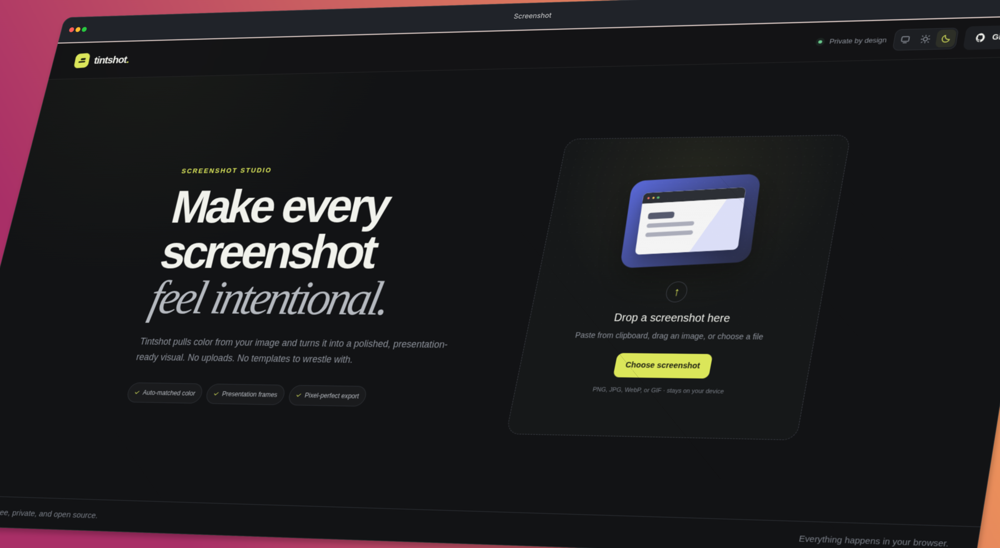

# Tintshot

> Screenshots that tint themselves.

**[Open Tintshot](https://tintshot.pages.dev/)**

Tintshot turns an ordinary screenshot into a polished, presentation-ready image.
It samples colors from the screenshot to create a matching background, adds an
optional device frame, and exports the result as a crisp PNG.

Everything runs locally in your browser. Images are never uploaded.



## Highlights

- **Automatic color matching** generates a background from the screenshot's
  dominant colors.
- **Flexible styling** includes two-color gradients, presets, angle controls,
  transparent backgrounds, padding, rounded corners, 3D tilt and zoom, and
  directional custom-color shadows.
- **Presentation frames** include clean, browser, desktop window, and phone
  styles.
- **Ready-made canvas sizes** cover original, 1:1, 4:5, 16:9, and 9:16 ratios.
- **Simple positioning** supports drag-to-crop, zoom, focal-point controls, and
  keyboard adjustments.
- **High-resolution output** supports 1x, 2x, and 3x PNG exports, including
  download and clipboard copy.
- **Private by design** requires no upload, account, or tracking.

## Quick start

### Requirements

- [Node.js](https://nodejs.org/) 22.22.2 or newer
- npm (included with Node.js)

### Run locally

```bash
git clone https://github.com/rdlugs/tintshot.git
cd tintshot
npm ci
npm run dev
```

Open the local URL printed by Vite in your browser.

## Using Tintshot

1. Paste, drag and drop, or choose a screenshot.
2. Use **Auto tint**, choose your own gradient colors, or remove the background
   color for a transparent canvas.
3. Select a frame and canvas ratio.
4. Adjust the screenshot's crop and crop zoom, padding, corners, complete-panel
   3D tilt and zoom, and shadow.
5. Choose an export scale, then download the PNG or copy it to your clipboard.

## Available commands

| Command           | Purpose                                                          |
| ----------------- | ---------------------------------------------------------------- |
| `npm run dev`     | Start the Vite development server.                               |
| `npm test`        | Run the layout and export regression tests once.                 |
| `npm run lint`    | Check the source with ESLint.                                    |
| `npm run format`  | Format the project with Prettier.                                |
| `npm run build`   | Type-check the project and create a production build in `dist/`. |
| `npm run preview` | Preview the production build locally.                            |

## How it works

Tintshot is a small, client-side React application written in TypeScript. The
rendering core is deliberately framework-free so it can be tested without a DOM:

- [`src/lib/colors.ts`](src/lib/colors.ts) downsizes the input, groups pixels
  into a coarse histogram, favors distinctive colors over near-white,
  near-black, and gray values, and builds a two-stop gradient.
- [`src/lib/beautifier.ts`](src/lib/beautifier.ts) calculates the canvas, frame,
  viewport, and crop geometry before drawing the final composition.
- [`src/state/`](src/state) holds every editor setting in one reducer, exposed
  through a context so panels read state and dispatch actions.
- [`src/hooks/`](src/hooks) wraps the browser-facing behavior: canvas rendering,
  crop dragging, image loading, clipboard paste, and toasts.
- [`src/components/`](src/components) contains the welcome screen, preview
  stage, and inspector panels, styled with Tailwind utilities.
- [`src/index.css`](src/index.css) defines the design tokens and the handful of
  rules — range thumbs, colour swatches, textures — that utilities cannot
  express.

## Contributing

Contributions are welcome. See [CONTRIBUTING.md](CONTRIBUTING.md) for setup,
development guidelines, and the pull request checklist.

Some useful areas to explore include batch exports, multi-stop gradients,
smarter palette extraction, saved presets, undo and redo, and additional export
formats.

## License

Tintshot is available under the [MIT License](LICENSE).
